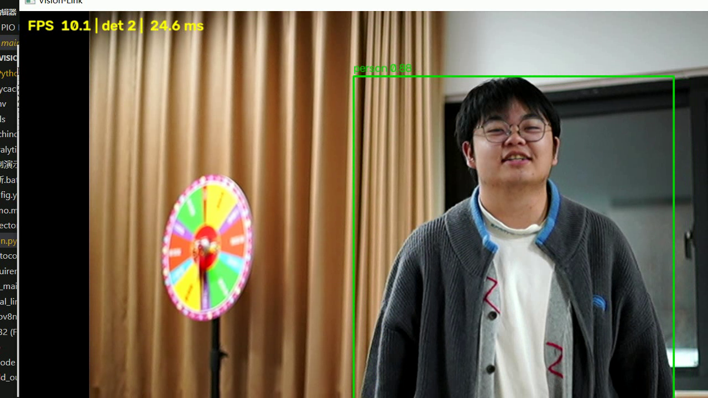

# Vision-Link：视觉自动构图云台

## 项目简介

Vision-Link 是一个视觉引导的自动构图云台。摄像头采集画面，PC 端运行 OpenCV + YOLOv8n 检测主体并计算主体中心与画面中心的偏差，通过自定义二进制协议经 USB 串口发送给 STM32F103；STM32 解析目标位置后输出 50 Hz PWM，驱动舵机云台转动，使主体保持在画面中心。

项目覆盖完整的端到端链路：图像采集、目标检测、串口通信、嵌入式解析与执行器控制。

## 功能

- 支持 USB 摄像头、HDMI 采集卡或视频文件作为输入；
- PC 端实时检测画面主体，输出目标框与中心坐标；
- 自定义二进制协议：`AA 55 | LEN | TYPE | SEQ | PAYLOAD | CRC8`；
- STM32 端使用 USART1 DMA + 空闲中断接收，环形缓冲 + 状态机解析；
- 按目标中心偏差输出 PWM，控制舵机云台自动构图；
- 提供 PING/PONG 链路延迟测试、模拟目标测试和窗口录制工具。

## 系统架构

```
┌─────────────────────── PC ───────────────────────┐        ┌──────────── STM32F103C8T6 ────────────┐
│                                                   │        │                                        │
│  相机 ──HDMI──> HDMI 采集卡 ──USB(UVC)──┐          │        │                                        │
│                                        ▼          │        │                                        │
│  或视频文件 ────────────────> OpenCV 取帧         │        │                                        │
│                                        │          │        │                                        │
│                              YOLOv8n / Haar 检测  │        │                                        │
│                                        │          │        │                                        │
│                        打包：AA55 | LEN | TYPE |  │ USB    │  USART1 DMA + IDLE 中断                │
│                              SEQ | PAYLOAD | CRC8 │──TTL──>│        ↓                               │
│                                        │          │ 115200 │  环形缓冲 → 状态机解析 → CRC8 校验      │
│                              pyserial 发送        │        │        ↓                               │
│                                                   │        │  舵机 PWM / OLED / LED / 蜂鸣器         │
│                              PING/PONG 回环测延迟  │<───────│  收到 PING 原样回 PONG                 │
└───────────────────────────────────────────────────┘        └────────────────────────────────────────┘
```

**设计边界**

STM32F103C8T6 没有 DCMI 摄像头接口和硬件 JPEG 解码，RAM 为 20 KB，无法在片内完成图像采集与视觉推理。系统将图像处理放在 PC 端，MCU 仅负责实时控制，避免将计算资源消耗在无法承载的任务上。这一分层方式与常见的机器人视觉、工业视觉系统一致。

## 硬件

| 硬件 | 用途 | 说明 |
|---|---|---|
| 洋桃1号开发板（STM32F103C8T6） | 主控与执行 | 64 KB Flash / 20 KB RAM |
| 相机 + HDMI 采集卡 | 图像输入 | UVC 免驱，Windows 识别为 `USB Video` |
| USB 数据线 | 供电与串口 | 接核心板 MicroUSB，支持下载与 USART1 通信 |
| 5V 舵机 + 云台 | 自动构图执行器 | 接 P7：GND / 5V / PA15 |
| 杜邦线 | 接线 | 舵机建议独立 5V 供电并共地 |

> 开发板上的 USB1 仅提供供电，不支持程序下载；调试与下载请使用核心板 MicroUSB。

## 目录结构

```
stm32-vision-link/
├─ pc/                      # PC 端（Python）
│  ├─ main.py               # 取帧、检测、协议打包、串口发送
│  ├─ detector.py           # YOLO / Haar 人脸 / 运动检测
│  ├─ protocol.py           # 协议打包、CRC8、帧解析
│  ├─ serial_link.py        # 串口发送封装
│  ├─ config.yaml           # 摄像头、分辨率、COM 口等配置
│  ├─ requirements.txt
│  └─ tools/
│     ├─ list_cameras.py    # 枚举摄像头与 DirectShow 序号
│     ├─ latency_test.py    # PING/PONG 测串口 RTT
│     ├─ fake_detection.py  # 模拟目标，单独验证执行链路
│     ├─ record_window.py   # 录制预览窗口
│     └─ serial_monitor.py  # 串口帧监视与解码
├─ stm32/                   # STM32 端（C / HAL）
│  ├─ platformio.ini
│  ├─ Inc/
│  └─ Src/
└─ docs/
   ├─ protocol.md
   └─ wiring.md
```

## 快速开始

### 1. PC 端

```bash
cd pc
python -m venv .venv
.venv\Scripts\activate
pip install -r requirements.txt -i https://pypi.tuna.tsinghua.edu.cn/simple
```

首次运行前确认摄像头序号：

```bash
python tools\list_cameras.py
```

典型输出：

```
0 | Integrated Webcam | 1280x720
1 | USB Video         | 1920x1080
```

将 `config.yaml` 中的 `source.index` 设为 `1`（采集卡），`serial.port` 设为 CH340 对应的 COM 口。

先预览画面：

```bash
python main.py --no-serial
```

确认检测框正常后，启动完整链路：

```bash
python main.py
```

### 2. STM32 固件

使用 PlatformIO：

```bash
cd stm32
pio run
pio run -t upload --upload-port COM3
```

串口下载需要将 USB 线接在核心板 MicroUSB，并确认板载 ASP 功能已开启。详细配置与 Keil 方案见 [stm32/README.md](stm32/README.md)。

### 3. 联调

```bash
python tools\latency_test.py --port COM3
python tools\fake_detection.py --port COM3 --seconds 10
```

## 通信协议

完整字节级说明见 [docs/protocol.md](docs/protocol.md)。

```
AA 55 | LEN | TYPE | SEQ | PAYLOAD | CRC8
```

| 字段 | 长度 | 说明 |
|---|---|---|
| 帧头 | 2 | 固定 `0xAA 0x55` |
| LEN | 1 | PAYLOAD 长度（0–96） |
| TYPE | 1 | 0x01 检测结果 / 0x02 PING / 0x03 PONG / 0x04 ACK |
| SEQ | 1 | 帧序号，0–255 循环 |
| PAYLOAD | LEN | 目标数据 |
| CRC8 | 1 | 多项式 0x07，覆盖 LEN/TYPE/SEQ/PAYLOAD |

检测负载：`frame_id(1) + n(1) + n × [cls(1) conf(1) x(2) y(2) w(2) h(2)]`，小端；坐标统一为 1280×720 逻辑分辨率。

## 性能指标

测试环境：STM32F103C8T6，115200 bps，PC 端 Python 3.11 + OpenCV 5.0 + YOLOv8n（CPU，imgsz=320）。

| 指标 | 结果 |
|---|---|
| 串口 RTT（100 次 PING/PONG） | 平均 3.67 ms，p95 4.07 ms，丢包 0 |
| PC 端处理耗时 | 约 18–19 ms/帧 |
| 检测帧率 | 约 10 fps（实时预览） |
| 固件占用 | Flash 9.4 KB / 64 KB（14.4%），RAM 1.3 KB / 20 KB（6.6%） |

## 演示

[](docs/demo.mp4)

[观看 30 秒演示视频](docs/demo.mp4)

## 设计说明

- **计算分层**：PC 负责目标检测与坐标计算，STM32 负责实时串口解析、PWM 输出和云台控制，避免在 20 KB RAM 的 MCU 上运行视觉模型。
- **协议设计**：帧头用于重同步，LEN 解决粘包/半包，CRC8 检测传输错误；固定长度目标结构便于在 MCU 上解析，不使用动态内存。
- **运动控制**：目标中心与画面中心的偏差按比例映射为舵机角度，加入 ±20 像素死区抑制中心抖动，并使用一阶低通滤波平滑转动。

## 常见问题

**Q：OpenCV 打开的是笔记本摄像头，不是采集卡？**

A：DirectShow 顺序中 `0 = Integrated Webcam`、`1 = USB Video（采集卡）`。将 `config.yaml` 的 `source.index` 改为 `1`，并关闭 Windows 相机或腾讯会议等可能占用采集卡的程序。

**Q：采集卡打不开或画面异常？**

A：先用 `tools/list_cameras.py` 确认序号；Windows 下使用 `cv2.CAP_DSHOW` 后端；1080p 输入建议设置 `fourcc=MJPG`。

**Q：串口无法打开？**

A：确认使用的是核心板 MicroUSB 枚举出的 CH340 串口，并关闭 FlyMcu、串口助手、PlatformIO Monitor 等占用串口的程序。

**Q：STM32 收不到数据？**

A：确认 USART1 的 DMA 为 Circular 模式、USART1 全局中断已开启，并检查 PA9/PA10 接线与共地。

**Q：舵机抖动？**

A：舵机使用独立 5V 电源并与板子共地；PWM 限幅 500–2500 μs；控制周期 20 ms，并在软件中加入死区与低通滤波。
